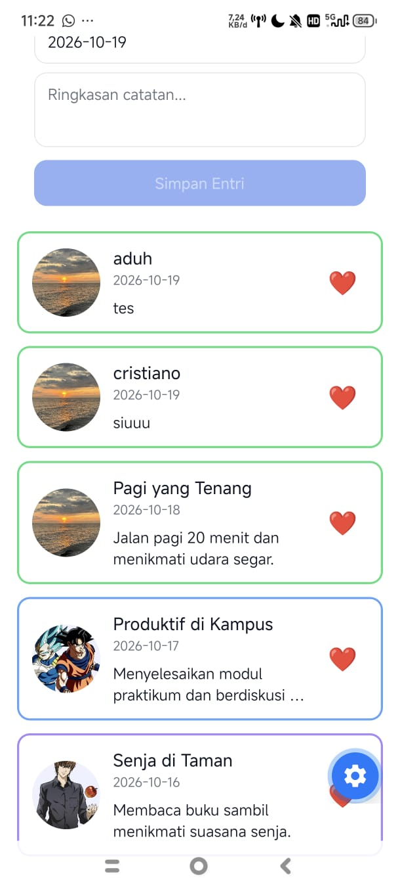
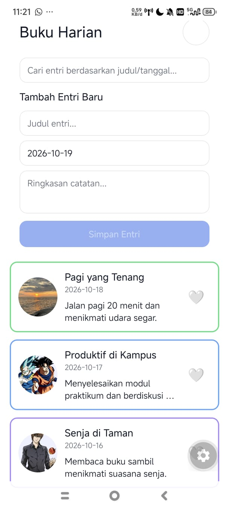

# **NAMA :** Gisal Dapa
# **NIM  :** 2430511023
# **KELAS:** 5A

# Diary App - Mobile Programming

Aplikasi Buku Harian (Diary App) interaktif dan responsif yang dikembangkan menggunakan **React Native** dengan **Expo CLI** sebagai bagian dari tugas praktikum Mobile Multi Platform.

## 🚀 Fitur & Pembaruan Terbaru
- **Manajemen State Terpusat (`DiaryListScreen`):** Mengelola state utama aplikasi secara terpusat mencakup `entries` (daftar entri), `query` (pencarian), `likedIds` (status suka), dan `selected` (modal detail entri).
- **Komponen Presentasional (`DiaryCard`):** Menggunakan komponen kartu mandiri yang menerima data dan callback (`onPress`, `onToggleLike`) melalui *props* secara fleksibel.
- **Fitur Pencarian Real-Time (`SearchBar`):** Dilengkapi *local state* dan callback `onChange` ke komponen parent untuk memfilter entri berdasarkan judul, ringkasan, atau tanggal secara instan.
- **Formulir Terkontrol (`EntryForm`):** Formulir input interaktif untuk menambah catatan harian baru secara dinamis ke dalam state aplikasi.
- **Sistem Suka (*Like*) Interaktif:** Status *like* disimpan menggunakan struktur data `Set` sehingga ikon hati dapat berubah (`❤️` / `🤍`) secara instan tanpa perlu *reload* aplikasi.
- **Layout Responsif (List & Grid):** Menggunakan `useWindowDimensions` dan *breakpoints* untuk menyesuaikan tampilan menjadi 1 kolom (list) di ponsel atau 2 kolom (grid) di tablet.
- **Aset Gambar Lokal & Border Dinamis:** Memuat gambar *mood* secara lokal dari folder `assets/moods/` dengan variasi warna pinggiran kartu (*border*) yang otomatis menyesuaikan jenis *mood*.
- **Safe Area & Aksesibilitas:** Tampilan aman dari *notch* menggunakan `react-native-safe-area-context` serta atribut aksesibilitas yang lengkap.

---

## 🛠️ Langkah Menjalankan Proyek

1. Pastikan **Node.js** dan aplikasi **Expo Go** (di perangkat seluler) sudah terinstal.
2. Buka folder proyek ini di Visual Studio Code.
3. Buka terminal lalu jalankan perintah berikut untuk menginstal dependensi:
   ```bash
   npm install

   

   
